<p align="center">
  <picture>
    <source media="(prefers-color-scheme: dark)" srcset="docs/brand/banner-dark.svg">
    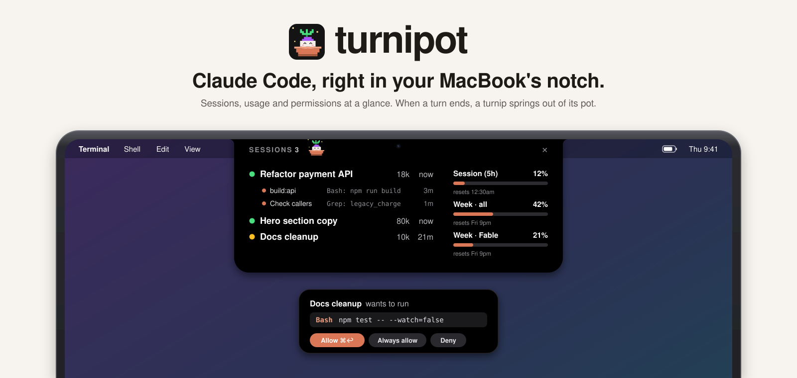
  </picture>
</p>

<p align="center">
  <b>Claude Code, right in your MacBook's notch.</b><br>
  Turnipot shows every Claude Code session in the notch: what it's doing, how full its context is and how much of your usage is left. Allow tool calls, answer Claude's questions and approve its plans from there, without hunting for the right terminal. When a turn finishes, a little turnip springs out of its pot to tell you.
</p>

<p align="center">
  
  
  
  
  
  
  <a href="LICENSE"></a>
  
</p>

---

## Why Turnipot

Running a few Claude Code sessions at once means a lot of window switching:

- **Which one is waiting on you?** A permission prompt sits in a terminal behind three other windows, and the session just stops until you find it.
- **Is it done yet?** You keep checking back on a long task, or you miss that it finished ten minutes ago.
- **How much is left?** Context fills up and the 5-hour limit runs out, and you only see it when it's too late.

Turnipot puts all of that where your eyes already are: the notch. Hover for the whole picture, answer from there, and get back to what you were doing.

<p align="center">
  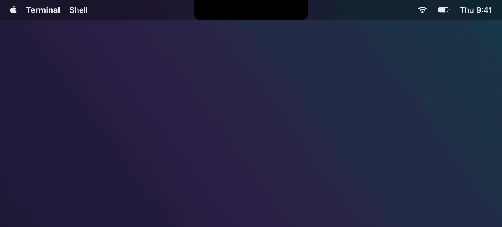
</p>

## Features

### Every session, one glance

The pill around the notch shows how many sessions are busy, your 5-hour usage, and a badge when something finished while you weren't looking. Hover to open the panel: each session with its status and **current context size** (compaction-aware: it drops right after `/compact`), plus your **account usage** for the 5-hour window and the week.

<p align="center">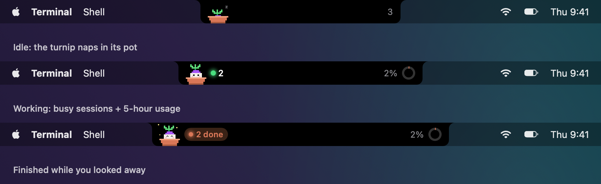</p>
<p align="center">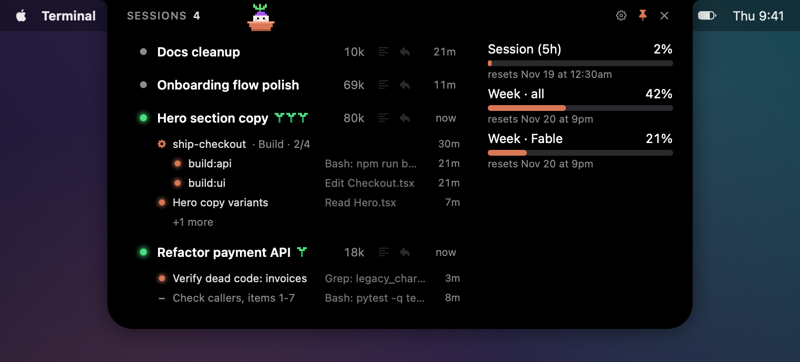</p>

**Subagent sprouts.** Running subagents show up as tiny pixel sprouts next to the session's title, with a compact list underneath: what each one is doing right now, workflow phases, and how long it's been running.

### Answer Claude from the notch

When Claude needs permission, the notch drops down with **Allow**, **Always allow** and **Deny** (⌘↩ / esc while you hover it). No window switching, and if you'd rather answer in the terminal, that still works. A drop-down ignores clicks and keys for its first 400 ms, so a click meant for something else can't approve it.

<p align="center">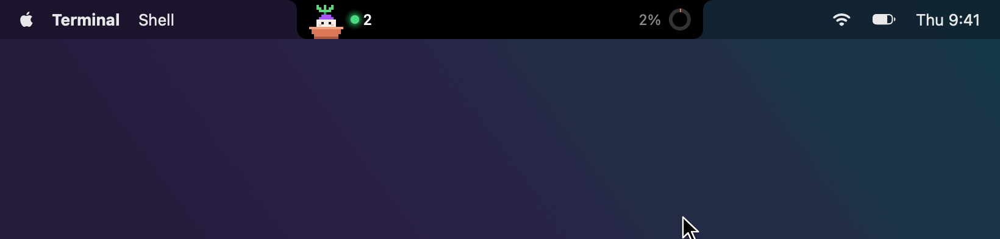</p>

It also handles **questions** (`AskUserQuestion`): pick options with a click or 1-9, multi-select, or type your own answer. And **plans** (`ExitPlanMode`): read the plan, approve it (optionally with auto-accept edits), or send it back with feedback.

<p align="center">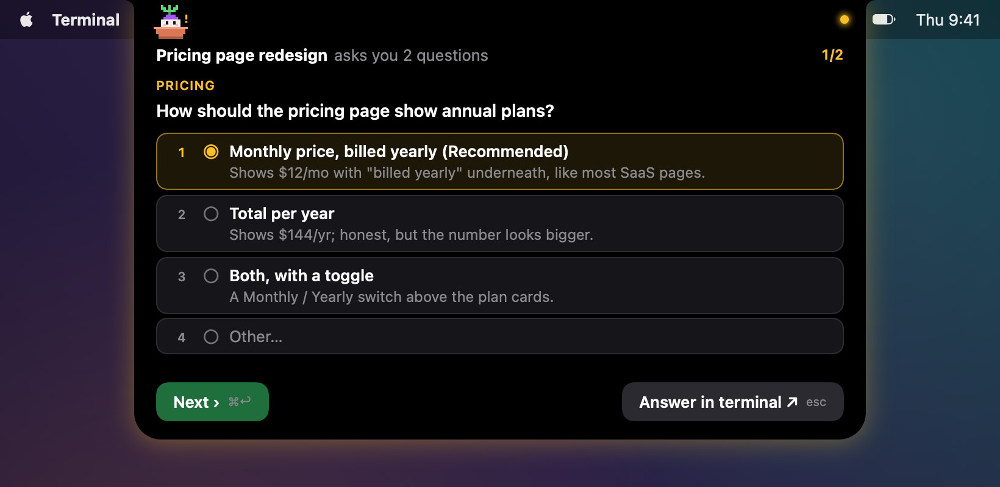</p>
<p align="center">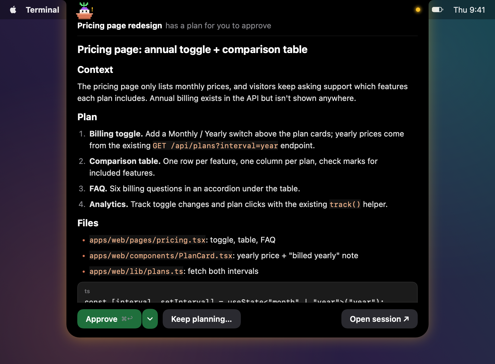</p>

### Read the reply without leaving what you're doing

Scroll down over a session to open its latest reply, rendered from Markdown (headings, lists, code blocks, tables). Page through the last ten turns and send a quick reply from the footer. While Claude may be showing a prompt in that terminal (you sent a request back there, or it timed out), quick reply is paused for the session so your Enter can't pick an option.

<p align="center">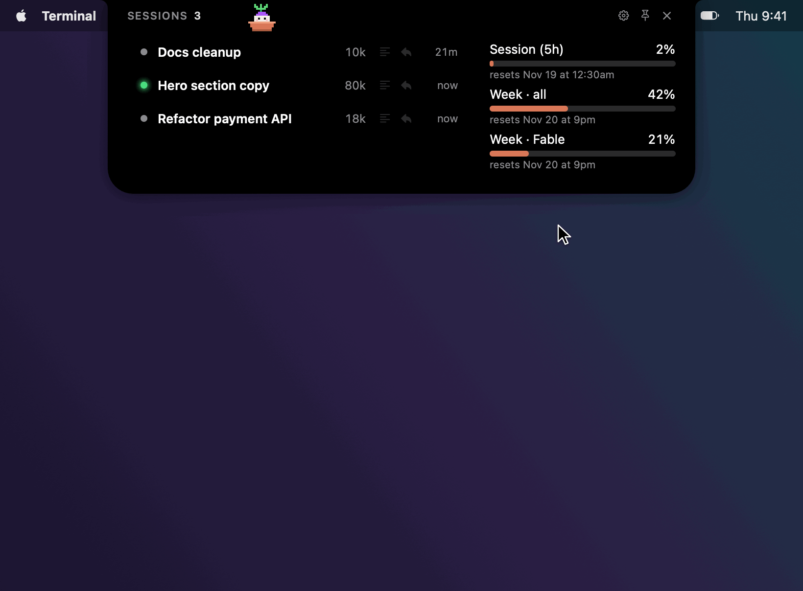</p>

### Know when it's done, even if you stepped away

When a session finishes, the notch drops down with Claude's last sentence and a reply field, and the turnip springs out of its pot. If you were away (screen locked, asleep, or idle), a **While you were away** summary waits for you instead.

<p align="center">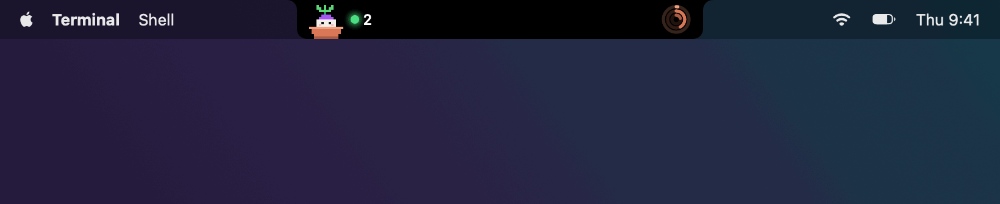</p>
<p align="center">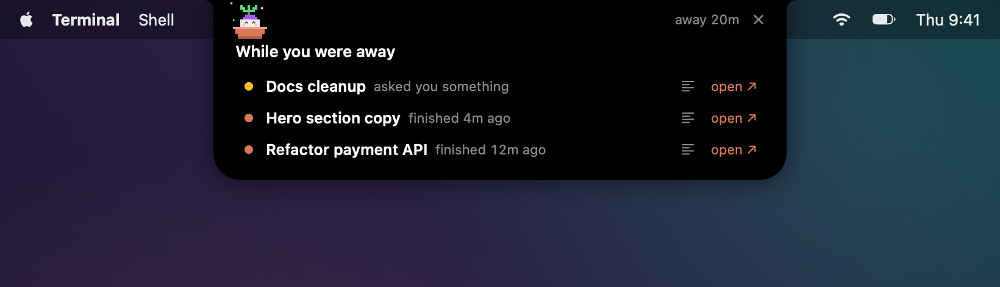</p>

### Works with your editor and Claude Desktop

- **VSCodium, VS Code and Cursor:** click a session to jump straight to its integrated terminal (the right window comes forward), or send a quick reply into it. Uses a tiny bundled bridge extension.
- **Claude Desktop:** sessions from the Code tab show up too; clicking one brings Claude Desktop forward.

### Meet the turnip

A little turnip lives in an orange pot in your notch. It naps while nothing runs, peeks out and bobs while Claude works, springs out of the pot when a turn ends, waves an amber "!" when Claude needs you, and wilts and sweats near your usage limit. Its leaves turn slightly olive as your weekly usage rises.

<p align="center">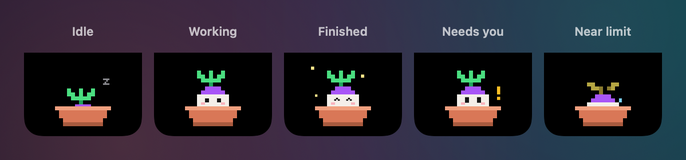</p>

### Trackpad haptics

Feel it as well as see it: a light tick as the pointer moves over sessions and buttons in the notch, a soft tap when the panel opens, two firm taps when Claude needs you, and a little launch-top-landing burst in time with the turnip's jump when a turn ends. Needs a Force Touch trackpad, and you only feel it while a finger rests on the trackpad. Turn it off with ⚙ (or right-click the notch) → **Trackpad haptics**.

## Install

### Download the latest release

1. Download `Turnipot-<version>.dmg` from [Releases](https://github.com/YlitaloJuha/turnipot/releases/latest), open it and drag **Turnipot** onto **Applications**. (A `.zip` of the same app is there too.)
2. Open it. Releases are signed with a Developer ID and notarized by Apple, so macOS opens them with a double-click. (0.3.0 and earlier were not: for those, right-click → Open → Open the first time.)
3. Set it up from the notch: hover it, click ⚙ (or right-click the notch) and choose
   - **Install Claude Code hook…** to answer permissions, questions and plans from the notch. It shows what will change in `~/.claude/settings.json` and backs the file up first. Choose it again later to remove the hook.
   - **Install editor extension…** for jump-to-terminal and quick replies in VSCodium, VS Code or Cursor (installed with each editor's command line tool; reload the editor windows afterwards).
   - **Launch at login**. The first time, macOS may ask you to allow it under System Settings → General → Login Items.

### Build from source

```sh
git clone https://github.com/YlitaloJuha/turnipot.git && cd turnipot
scripts/build-app.sh            # builds build/Turnipot.app (needs the Xcode Command Line Tools)
scripts/install-app.sh          # copies it to /Applications, relaunches it and points the hook there
```

A build from source is signed ad hoc, which is fine on the Mac that built it. `install-app.sh` copies the app to /Applications (or ~/Applications if that isn't writable), quits the running copy, opens the installed one and runs `scripts/install-hook.sh --hook /Applications/Turnipot.app/Contents/Helpers/turnipot-hook`, so the hook keeps working after you delete `build/` (`--no-hook` skips that). Then turn on **Launch at login** in ⚙. The scripts `install-hook.sh` (`--dry-run`, `--uninstall`) and `install-extension.sh` do the same as the ⚙ menu items. To run straight from the build folder instead: `scripts/build-app.sh --open`.

## Requirements

- macOS 14 Sonoma or later
- A MacBook with a notch. Macs without one get a small pill at the top centre of the screen.
- [Claude Code](https://code.claude.com) installed
- To build from source: the Xcode Command Line Tools (`xcode-select --install`); Xcode itself isn't needed
- Optional: VSCodium, VS Code or Cursor for jump-to-terminal and quick replies

## Privacy

Everything runs locally on your Mac:

- Turnipot reads Claude Code's own files under `~/.claude` (session list and transcripts, read-only).
- Usage numbers come from running your own `claude -p "/usage"` every two minutes. It doesn't call a model.
- The only network request Turnipot makes is the update check: once at launch and once a day, an anonymous `GET https://api.github.com/repos/YlitaloJuha/turnipot/releases/latest` (User-Agent `Turnipot/<version>`, no cookies, nothing about you or your sessions). Turn it off with ⚙ → **Check for updates**. There's no telemetry or analytics, and it doesn't read keychain items or OAuth tokens.
- The hook and the editor extension talk to the app over Unix sockets in `~/Library/Application Support/Turnipot/` (mode 0600).

## How it works

- **Sessions and usage:** Turnipot polls `~/.claude/sessions/*.json`, reads the tail of each transcript for titles, context size, the last reply and subagents, and parses `claude -p "/usage"`.
- **Permissions, questions, plans:** a tiny hook binary (`turnipot-hook`) runs for Claude Code's `PermissionRequest` event and asks the app over a socket. If the app isn't running or you don't answer, the hook steps aside and Claude shows its normal terminal prompt.
- **Editors:** the bridge extension lets the app focus a session's integrated terminal and type a reply into it.

The details, including the exact hook I/O, are in [CONTRACTS.md](CONTRACTS.md). For build flags, demo and render modes, `--dump`, media export and the full behaviour reference, see [docs/DEVELOPMENT.md](docs/DEVELOPMENT.md).

## Uninstall

```sh
# First: ⚙ → turn off Launch at login, and ⚙ → Install Claude Code hook… → Remove
# (or from a clone: scripts/install-hook.sh --uninstall; scripts/install-extension.sh --uninstall)
pkill -f Turnipot.app                     # or right-click the notch → Quit Turnipot
rm -rf /Applications/Turnipot.app "$HOME/Library/Application Support/Turnipot"
defaults delete com.juhaylitalo.turnipot  # the settings (mascot, haptics, update check)
```

The editor extension is listed as "Turnipot Bridge" in each editor's Extensions view.

## Contributing

Bug reports and ideas are welcome as [issues](https://github.com/YlitaloJuha/turnipot/issues). How to build, test and send a change: [CONTRIBUTING.md](docs/CONTRIBUTING.md). Found a security problem? Please report it privately, as [SECURITY.md](docs/SECURITY.md) says.

## No warranty

Turnipot is free software, provided **as is**, without any warranty, and you use it at your own risk. The author isn't liable for anything that happens because you used it: lost work, a command you allowed from the notch, a reply typed into the wrong terminal, or anything else. The [MIT licence](LICENSE) says this in legal terms, and it is what applies.

Turnipot can answer Claude Code on your behalf. What you allow, approve or send from the notch is your decision, just as it is in the terminal: read the request before you click.

## Disclaimer

Turnipot is an independent project and is not affiliated with or endorsed by Anthropic or Apple. Claude and Claude Code are trademarks of Anthropic. MacBook and macOS are trademarks of Apple.

## Licence

[MIT](LICENSE) © 2026 YlitaloJuha
